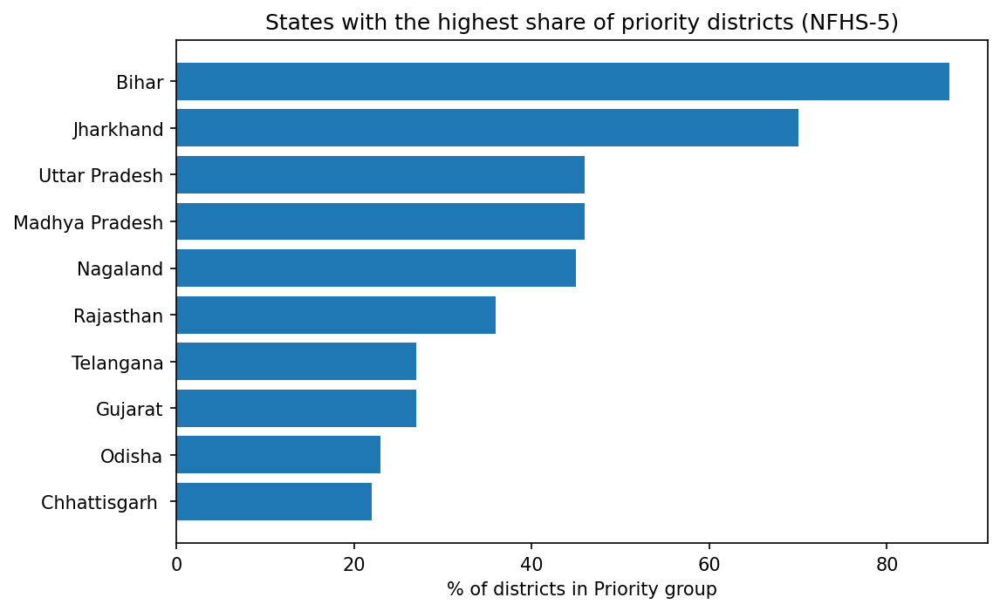
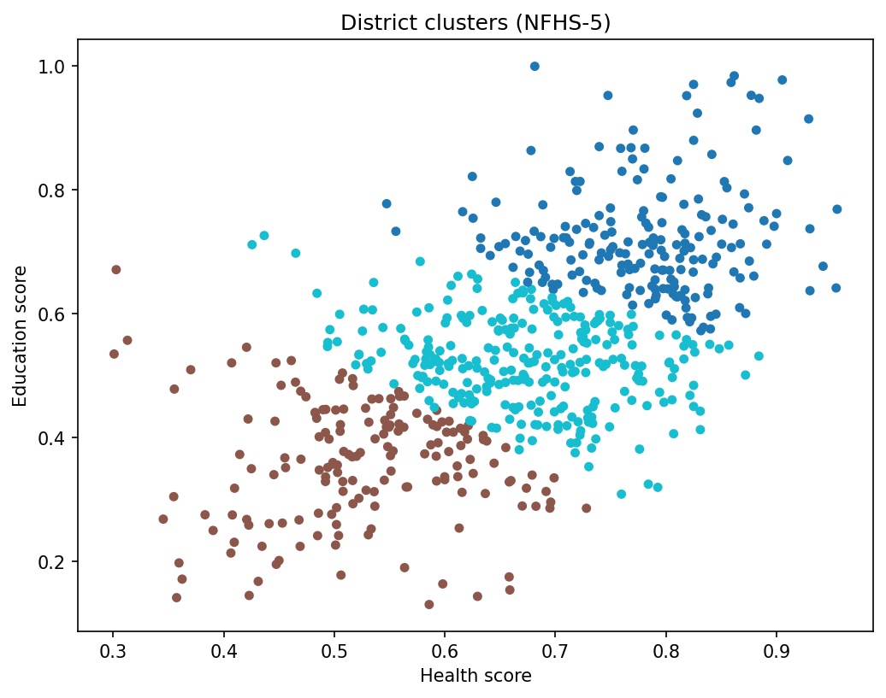

# District Development Index (NFHS-5)

Which Indian districts need the most help, and in which sector: health or education?

This project combines district-level health and education indicators from NFHS-5 (2019-21) into one **District Development Index** for 642 districts, groups the districts by their pattern of weakness, and turns the results into a short policy brief and an interactive dashboard.

**Live dashboard:** [https://datastudio.google.com/reporting/429e7dbe-e88b-4439-bcc2-8dfa4b0b4739]
**Policy brief (PDF):** [brief/policy_brief.pdf](brief/policy_brief.pdf)

---

## Key findings

- **642 districts** across 37 states and union territories were scored using 7 NFHS-5 indicators.
- **167 districts (26%)** fall in the "Priority: weak on both" group, with an average index of 44 compared with 75 for the higher-performing group.
- Priority districts are concentrated: **Bihar** (33 of 38 districts) and **Jharkhand** (16 of 23) lead, followed by **Uttar Pradesh** (33 of 71) and **Madhya Pradesh** (23 of 50). These four states hold about 63% of all Priority districts.
- The ranking is stable. An alternative PCA-weighted index gives a Spearman correlation of **0.993** with the equal-weights index, and **48 of the 50** lowest-ranked districts are the same under both.
- Districts have different kinds of problems. Education trails health in Mewat, Shrawasti and Bahraich, while health trails education in parts of the North-East such as Zunheboto and Tuensang.




---

## Questions this project answers

1. Which districts rank lowest on a combined health and education index?
2. Does the ranking change if the weights change?
3. Are low-ranked districts weak in the same way, or do they need different policies?
4. Which states hold the largest share of the weakest districts?

---

## Data

| Source | What was used |
|---|---|
| [NFHS-5 district fact sheets](https://rchiips.org/NFHS/factsheet_NFHS-5.shtml) (official, PDF) | Health and education indicators, 2019-21 |
| [Community CSV conversion of NFHS-5](https://github.com/SaiSiddhardhaKalla/NFHS) | District-wise CSV files used in this project |

The district CSV files are an unofficial conversion of the official PDFs, so some values may contain conversion errors. See the limitations below.

### Indicators used

| Sector | Indicator | Direction |
|---|---|---|
| Health | Children under 5 who are stunted (%) | lower is better |
| Health | Children under 5 who are underweight (%) | lower is better |
| Health | Institutional births (%) | higher is better |
| Health | Children fully vaccinated (%) | higher is better |
| Education | Women who are literate (%) | higher is better |
| Education | Female population age 6+ who ever attended school (%) | higher is better |
| Education | Women with 10 or more years of schooling (%) | higher is better |

---

## Method

1. **Load and combine.** 37 state files were combined into one table of 66,976 rows (one row per district per indicator, 105 indicators in total).
2. **Select and reshape.** The 7 indicators above were pulled out and reshaped to one row per district. A value of 0 in the source was treated as missing for these indicators.
3. **Normalise.** Each indicator was min-max scaled to 0-1. Stunting and underweight were reversed so that a higher score always means better.
4. **Score.** The health score and the education score are the averages of their indicators. The **development index** (0-100) is the average of the two sector scores. Districts missing a whole sector were dropped, leaving 642.
5. **Check the weights.** A second index was built from the first principal component (PCA, which explains 54.7% of the variation). The two rankings were compared with Spearman correlation and with the overlap of the bottom 50 districts.
6. **Cluster.** K-Means was run on the health and education scores with k = 3 to 5. k = 3 was chosen because it had the highest silhouette score (0.36). The groups were named by their average index: Higher-performing (197 districts), Middle (278) and Priority: weak on both (167).
7. **Compare sectors.** The gap between the health score and the education score was used to find districts that are weak mainly in one sector.
8. **Visualise.** The final table was loaded into a 3-page Looker Studio dashboard.

---

## Dashboard

The Looker Studio report has three pages:

1. **Overview:** (dashboard/page1_overview.png).
2. **States:**(dashboard/page2_states.png).
3. **Districts:** (dashboard/page3_districts.png)

---

## Repository structure

```
district-development-index/
├── README.md
├── data/
│   ├── raw/          # NFHS-5 state CSV files
│   └── clean/        # cleaned and scored tables
├── notebooks/        # Google Colab notebook(s): cleaning, index, clustering
├── dashboard/        # dashboard screenshots and chart images
└── brief/            # policy brief (PDF)
```

---

## How to reproduce

1. Download the state CSV files from the NFHS source above and save them in `data/raw/_states/`.
2. Open the notebook in Google Colab and mount Google Drive.
3. Run the cells in order. They create the cleaned table, the index, the clusters, and the final file `district_final.csv`.
4. Upload the final CSV to Google Sheets and connect it to Looker Studio.

Python libraries: pandas, numpy, scikit-learn, scipy, matplotlib.

---

## Limitations

- The index uses **health and education only**. It has no income, employment or infrastructure indicators.
- NFHS-5 data are from **2019-21** and may not reflect the present.
- District estimates from a sample survey have **sampling error**, especially in small districts and small states (for example Nagaland, where 5 of 11 districts are in the Priority group).
- Health and education scores move together, so the three groups are mostly **levels** of development, not three distinct types of problem.
- The district CSV files are an **unofficial conversion** of official PDFs and were only spot-checked.
- **Equal weights are a judgement.** The PCA check shows the ranking is stable, but it does not prove equal weights are correct.
- Districts with a missing sector score were dropped.

## Next steps

- Add school dropout (UDISE+) and a district-level employment indicator.
- Add a district map using a boundary file.
- Compare NFHS-5 with NFHS-4 to show which districts are improving fastest.

---

## Author

**Rohan Lakade**: Computer Science student interested in data analytics and business intelligence.
[LinkedIn](www.linkedin.com/in/rohan-lakade-913a502a7 ) · lakaderohan16@gmail.com
